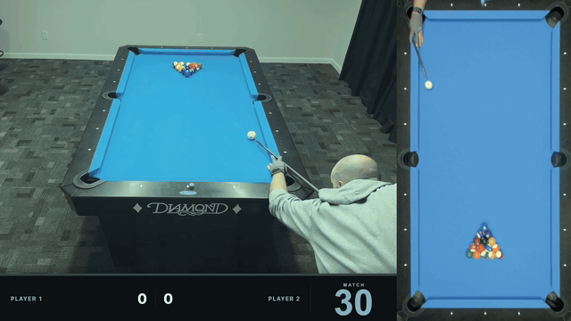

# cueclock

Automated shot clock for Ultimate Pool (USA 8-ball) solo practice, driven by an
overhead machine-vision camera. A Basler ace 2 (1920×1200, global shutter,
~156 fps) watches the table from the ceiling; classical segmentation + per-ball
tracking in true table millimeters detects shots, settles, and scratches; the
events drive a shot-clock state machine rendered as an OBS overlay on a wall
TV, controlled from a Stream Deck. Everything runs on one Mac mini.

## Demo

[](docs/media/demo.mp4?raw=true)

**[▶ Full demo — 2:44, with sound](docs/media/demo.mp4?raw=true)**

A real practice session: overhead and side-angle feeds composited with the live
shot clock and scoreboard. The clock starts on the detected strike and resets on
the settle, with no operator touching anything.

## Status (July 2026): the rig is live

Hardware installed and calibrated; the clock runs real practice sessions.
Detection accuracy work is ongoing — every live miss gets captured by a
Stream Deck "Flag" key (last ~20 s of raw frames → a clip named for the
failure reason) and turned into a graded regression scenario. Current
corpus: 54 scenarios, all green.

| Piece | State |
|---|---|
| Basler a2A1920-160ucBAS + Kowa 3.5 mm, ceiling mount | live, settings locked in UserSet1 |
| Vision pipeline (`cueclock run`): detect → track → events → clock | live |
| OBS: Syphon table feed + clock overlay → wall TV (Hisense 55" CanvasTV) | live |
| Stream Deck MK.2 (`cueclock deck` daemon, no Elgato software) | live — Session / Mode / Replay / Flag / Start N / Push / Extension / Ruleset / New Rack / score. Keys that the current mode can't use go dark rather than dim (`hardware.md` §C) |
| Session modes: match · run out · no clock — orthogonal to the ruleset | live |
| Match mode: WNT 9-ball rack context (60 s first shot, per-rack extensions), scoreboard overlay | live |
| Voice "extension" (built-in mic, offline Vosk) | live |
| Session toggle (one key powers the TV on, brings up `run` + OBS + the projector — and takes it all back down) | live |
| Instant replay: one key cuts the TV to the last shot (seeked to 1.5 s before it), or held, to the whole rack from its break | live |
| Replay stinger + slow-mo, music keys, drill tracking | planned — [work board](https://github.com/users/grassten/projects/3) |

## How it works

```
grab thread (BayerRG8 @ 156 fps)
 ├─► ring buffer (last ~20 s, POST /api/dump saves it as a corpus clip)
 ├─► detection @ 156 Hz (3 worker threads): |frame − empty-table reference| → blobs → tracker
 │      → undistortPoints + homography → table mm → event engine
 │      → ShotTaken / BallsSettled / Scratch → clock state machine
 │      → FastAPI + WebSocket → OBS browser-source overlay + Stream Deck
 └─► display @ 30 fps: edge-aware debayer → undistort → Syphon → OBS → TV
```

Design commitments (rationale in `docs/design.md` — don't relitigate casually):
classical segmentation against an empty-table reference, **no neural detector**;
all thresholds in physical units; detection runs on distorted pixels (only
coordinates get undistorted); the vision core is **pure** —
`(frame, timestamp) in → events out`, no I/O, no clocks, no threads — so
recorded-clip replay tests are deterministic.

## Running it

```bash
# the session (camera + vision + clock + server + Syphon display):
uv run python -m cueclock.cli run --rectify --host 0.0.0.0 --fps 60

# the Stream Deck daemon (normally installed as a launchd agent):
uv run python -m cueclock.cli deck
```

- At the table there is no keyboard: the deck's **Session** key (top-left)
  runs that first command for you and launches OBS behind it — tap to start,
  hold 1 s to stop (`docs/hardware.md` §C4).
- The empty-table reference is whatever `config/reference.json` names.
  After a camera bump, or when the startup drift check warns that the
  reference has gone stale: clear the cloth, stop the session and **hold the
  deck's RECAL key 2 s** (or run `uv run python -m cueclock.cli recalibrate`).
  It records a fresh reference, refits both calibrations, and swaps them in
  only if the fit is good (`docs/hardware.md` §E2). The next start uses it.
- OBS browser sources: `http://localhost:8000/shotclock?view=bar` (the live
  scene's bottom bar — clock *and* scoreboard in one 1334×1080 source at
  (0, 0); enable "Control audio via OBS" **and** set Audio Monitoring to
  "Monitor Only (mute output)" — that is what sounds the chimes on the TV.
  Recorded audio comes from the unmuted Mic/Aux source instead — the room, so
  cue strikes, the break, you, and the TV's own chimes exactly once
  (`hardware.md` Part D)),
  `http://localhost:8000/shotclock?view=full&audio=off` (full-screen
  broadcast-style clock scene), `http://localhost:8000/replay` (the REPLAY
  badge — lives only in the Replay scene, which `scripts/setup_obs_replay.py`
  builds; never assemble it by hand), and `http://localhost:8000/bracket` (the
  double-elimination bracket, its own scene, built by
  `scripts/setup_obs_bracket.py`). Phone control page: `/control` — two tabs:
  Play (clock keys, scores) and Setup (players, race, ruleset — or the whole
  tournament behind its Single match / Tournament toggle).
- **Tournament nights** (issue #43): the Setup tab's Tournament side on
  `/control` builds a
  double-elimination draw from FargoRate ratings (or typed estimates on the
  same scale), handicaps every match FargoRate-chart style, and drives the same
  scoreboard the casual nights use. Players score from their own phones on the
  LAN; the Stream Deck's confirm key commits a result, loads the next match and
  puts the updated bracket on the wall. **With no bracket loaded every page
  behaves exactly as it does without the feature** — that is what makes the
  casual night and the tournament night the same software.
- Voice "extension": say the word and the clock grants one — and the overlay
  announces "Extension called" back, for that call and for the deck key alike.
  Needs the Vosk model (`scripts/fetch_vosk_model.sh`, once) and a microphone —
  the Mac mini has none built in, so it defaults to the side-angle camera's
  own mic (`Insta360 Link 2C Pro`). Any other is named with
  `--mic-device`. `cueclock listen` is the bring-up/soak tool
  (`docs/hardware.md` Part D).
- Side-angle camera settings (`cueclock sidecam`): exposure, white balance,
  focus and the mic's noise suppression are saved once and re-applied at every
  session start, so Insta360 Link Controller never has to be open during play.
  Needs `scripts/fetch_insta360_sdk.sh` once (`docs/hardware.md` §F2).
- Other subcommands: `record`, `replay`, `analyze`, `calibrate`,
  `fit-undistort`, `live` — see `--help`.

## Development

```bash
uv sync                      # venv + deps (incl. dev group)
uv run pre-commit install    # one-time: git hooks
uv run pytest                # unit tests everywhere; corpus tests need the T7
uv run pytest -n 4           # full battery, ~5 min (add --detect-cache: ~21 s)
uv run ruff check . && uv run mypy
```

- **uv only** — `uv add <pkg>`, never bare pip.
- Test clips are real table footage: local-only, gitignored, on an external
  SSD behind the `tests/clips` symlink (see `tests/README.md`). Clip-based
  tests skip cleanly when the drive is absent; unit tests always run.
- The corpus scoreboard (`tests/corpus/`) is the accuracy ground truth —
  every detection change is graded against all recorded scenarios. Two tiers:
  cold is the gate, `--detect-cache` is the iteration loop (`tests/README.md`).

## Documentation

| File | What it holds |
|---|---|
| `docs/design.md` | Architecture, detection design, event logic, engineering standards, corpus checklist — the plan of record (§ numbers are cited from code) |
| `docs/hardware.md` | Camera settings & bring-up · video path to OBS/TV · Stream Deck (living button map) · mic plan · TV & recalibration recipes |
| `docs/cli.md` | CLI reference — every command, flag, and the common recipes |
| `BACKLOG.md` | Pointer to the work board, and how it's organised |
| `CHANGELOG.md` | Dated checkpoint log + build decisions (append-only) |

This project supersedes an iPhone-based prototype
([grassten/pool-room](https://github.com/grassten/pool-room), archived) that
plateaued at ~90–95% shot-detection accuracy; its distilled lessons are
`docs/design.md` §2.3.

## License

[MIT](LICENSE)
