# cueclock

A shot clock for pool that runs itself. A machine-vision camera above the table
tracks every ball in table millimetres, and the clock takes its cues from the
balls: it starts off the break, freezes while balls are moving, and gives the
next shot a fresh countdown when they come to rest. Nobody operates it. It draws
itself under a two-camera view of the table on a wall TV and on a YouTube
stream, and it is run from a Stream Deck and a phone.

It exists because practising against a shot clock alone means either ignoring
the clock or stopping to press a button after every shot.

[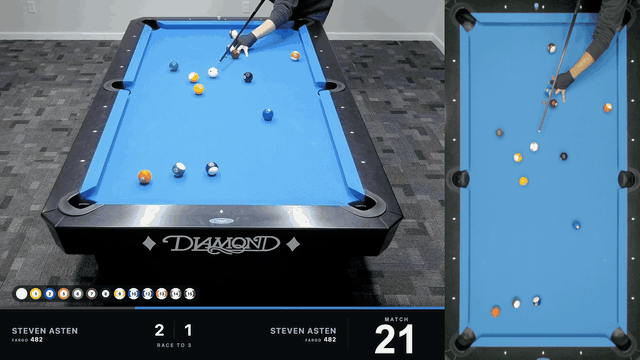](https://youtu.be/fJwlt1WiWNM)

**[▶ Watch a full session on YouTube](https://youtu.be/fJwlt1WiWNM)** (27 minutes).
In the clip above the clock counts down while the shot is lined up, freezes at
the strike, and comes back at 30 when the last ball stops. The row of numbered
chips above the bar is the table as the camera reads it: a potted ball leaves
it. The only key pressed in a rack is New Rack, between games.

This is one room's rig, published as it stands: one table, one cloth, one ball
set, one camera position. It is not a product and no effort has gone into making
it easy to reproduce. What may be useful to someone else is the record of what
it took to get a camera to agree with a pool player about when a shot has been
played, which is most of this page.

## Contents

- [How well it works](#how-well-it-works)
- [The parts](#the-parts)
- [How detection works](#how-detection-works)
- [The hard cases, and what the clock does in each](#the-hard-cases-and-what-the-clock-does-in-each)
- [Considered and rejected](#considered-and-rejected)
- [What still goes wrong](#what-still-goes-wrong)
- [The rig](#the-rig)
- [In a different room](#in-a-different-room)
- [Try it with no hardware](#try-it-with-no-hardware)
- [Running it on the rig](#running-it-on-the-rig)
- [Development](#development)
- [Where the reasoning is](#where-the-reasoning-is)
- [The small print](#the-small-print)

## How well it works

Every session writes a journal of what the clock saw and did. Over all of them,
117 sessions from 1 August to 26 November 2026, the clock counted 2,838 shots in
214 racks.

**99.6% of those shots were counted with the clock in the right state and no key
pressed.** Two things count against that number: the buzzer sounding through a
shot that was being played (9 times), and a shot counted while the cue ball had
not moved (2 times). The clock also started three times while the balls were
being racked; those are left out, because no game was being played. Counting
every key press that rescued the clock as well (a break started by hand, a
frozen countdown restarted), 98.6% of shots needed no key at all. The break started the clock by itself in 206 of the 214 racks.

These figures come from the clock's own journals
([`.claude/skills/session-stats`](.claude/skills/session-stats/SKILL.md)), not
from hand-labelled video. A failure shows up as a key press or as a reading
that cannot be true, and a shot that left neither a strike nor a settle leaves
no trace at all. Journals from before 17 November cannot see the second kind of
failure, so for them the figure is an upper bound.

The iPhone prototype this replaced
([grassten/pool-room](https://github.com/grassten/pool-room)) plateaued at an
estimated 90 to 95%. The lessons it paid for are in
[`docs/design.md`](docs/design.md) §2.3, and several of them are rows in the
tables below.

## The parts

Five programs run on one Mac mini, which is also wired to the TV.

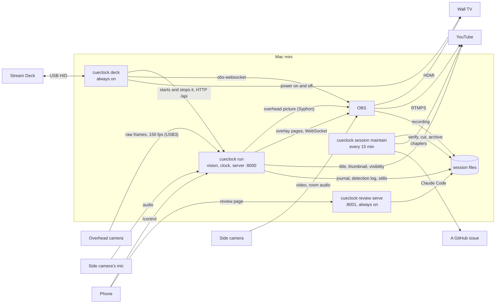

| Program | Started by | What it owns |
|---|---|---|
| `cueclock run` | the deck's Session key, or a terminal | the camera, detection, the clock, the HTTP and WebSocket server on port 8000, the picture it hands OBS, the voice listener, the YouTube calls, the journal and the session log |
| `cueclock deck` | a launchd agent, always on | the Stream Deck, and the session's life: it starts and stops `run`, OBS, the recording, the stream and the TV |
| OBS | the deck | composing the picture, the fullscreen output on the TV, the recording, the stream |
| `cueclock review serve` | a launchd agent, always on | the review page on port 8001 |
| `cueclock session maintain` | a launchd agent, every 15 minutes | everything after a session: checking it, cutting clips, archiving, purging, chapters, the review agent |

`run` is the only one the clock needs. Everything else is presentation, control
or housekeeping.

### The wall and the stream

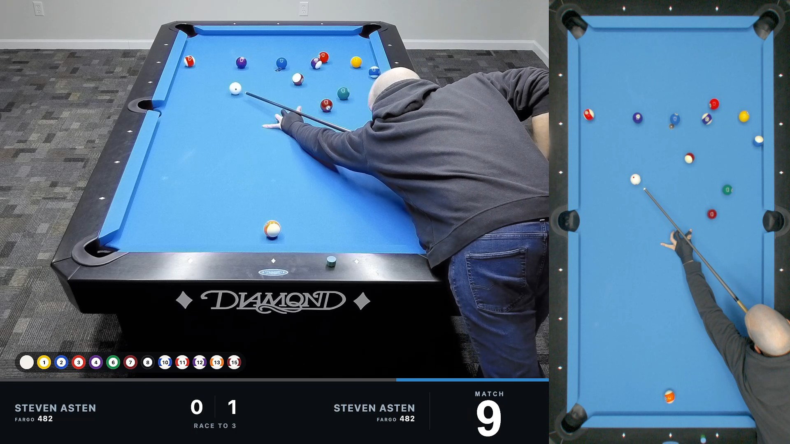

OBS composes one picture and sends it three ways: to the TV, to a recording and
to YouTube. The side camera fills most of it. The overhead camera's picture,
undistorted and turned on its side, is the strip on the right. The bar along
the bottom is a web page served by `run` (`/shotclock?view=bar`) and laid over
the video: names and FargoRate ratings, the score and race, the clock, and a
gauge that drains across the bar's top edge with the countdown. The chips above
it are the [ball list](#10-the-ball-list).

The same page has two other views: a bare full-screen number
(`/shotclock?view=full`, the "Shot Clock" scene) and a square tile. The
committed [scene collection](assets/obs/scene-collection.json) is the OBS layout
exactly as it runs here.

The clock is heard as well as seen. The page makes a soft tone at 10 seconds, a
blip on each of the last five, and a buzzer at zero. A granted extension is
answered with a spoken "Extension called". OBS plays these through the TV.

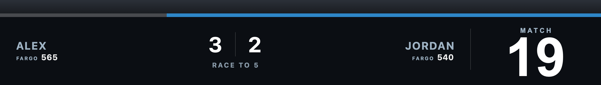

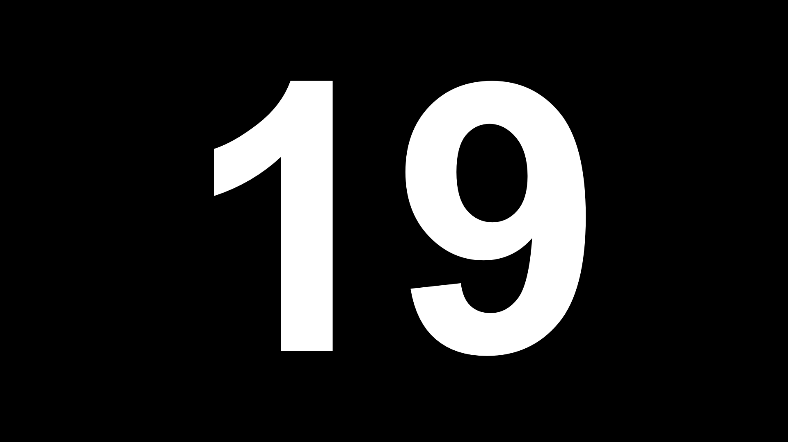

### The control page

A phone on the same network opens `/control`. It has two tabs.

| Play | Setup | Setup, tournament side |
|---|---|---|
| 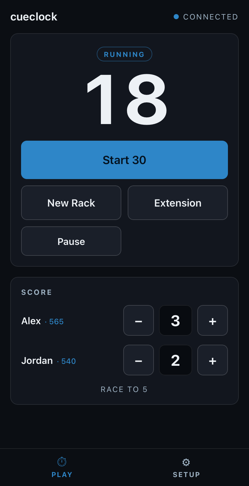 | 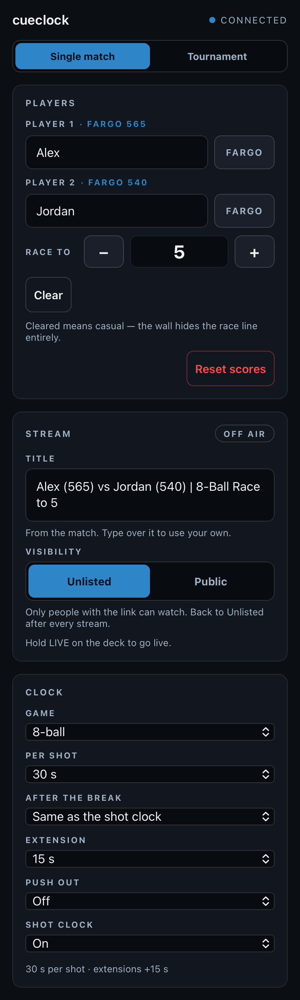 | 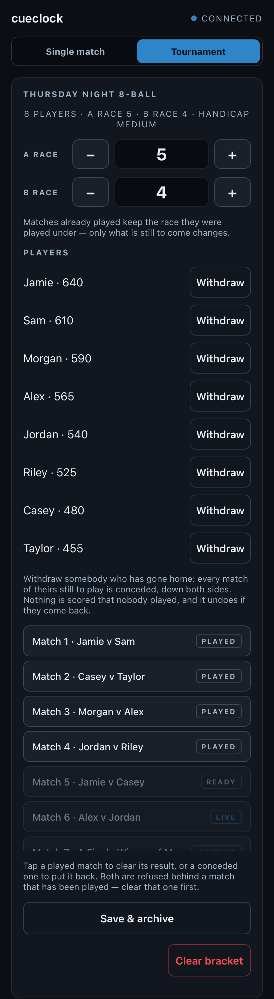 |

**Play** is the clock by hand: Start (a fresh countdown, running at once), New
Rack, Extension, Push and Pause, with plus and minus for each score underneath.
With a tournament loaded it also shows the match and its Report result button.

**Setup** holds everything that is set once: the two names (each with a button
that looks the player up on FargoRate), the race, the six clock settings, the
Stream section, switches for the ball strip and for voice, and a health line
with the detection rate and the reference's drift. Its other side builds a
tournament.

The six settings, first value the default:

| Setting | Values | What it does |
|---|---|---|
| Game | 8-ball, 9-ball, 10-ball, other | names the stream; no clock rule reads it |
| Shot | 30, 15 | seconds for a shot |
| After the break | same, 60 | seconds for the first shot after the break, and after a push out |
| Extension | 15, 30 | seconds an extension adds |
| Push | off, on | shows the Push control |
| Clock | on, off | off means no shot clock at all |

Apart from the settings there are three modes. **Match** has racks: the break
is untimed and the first shot after it gets the after-the-break time. **Run
out** has no rack, so every shot gets the shot time. **No clock** records what
the camera sees and never moves the clock.

### The Stream Deck

| Mid-match | The Setup menu |
|---|---|
| 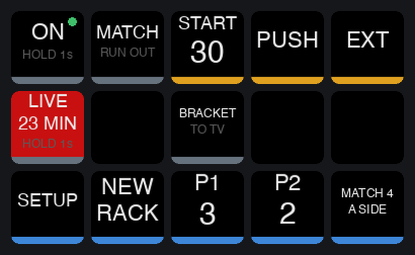 | 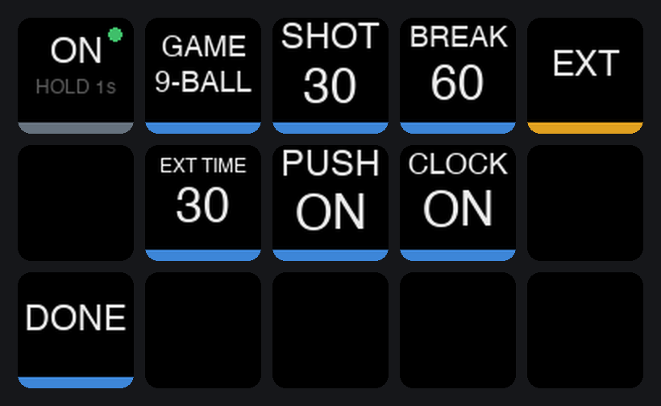 |

A 15-key Stream Deck MK.2 sits at the table, driven directly by `cueclock deck`.
Elgato's own software is not installed and must not be: it would take the
device. A key that cannot be pressed right now is dark, not dimmed.

| Key | Press | What it does |
|---|---|---|
| Session | tap to start, hold 1 s to stop | brings the whole rig up or down (below) |
| Mode | tap | match, run out, no clock |
| Start | tap | a fresh countdown, running now; the face shows the number it will give |
| Push | tap | a push out |
| Ext | tap | an extension |
| Live | hold 1 s | go live on YouTube; hold again to stop |
| Bracket | tap | swap the TV between the table and the bracket |
| Recal | hold 2 s, session off | [recalibrate](#recalibration) |
| Setup | tap | opens a menu of the six settings; each press steps one setting |
| New Rack | tap | the rack is over; the clock goes idle until the next break |
| P1, P2 | tap +1, hold −1 | the score |
| Confirm | tap | commits a tournament result and loads the next match |

**The Session key is the on switch for the room.** A tap wakes the TV, starts
`run`, and, once the server answers, starts OBS. Then it checks the TV is on,
points OBS at this run's picture, opens the fullscreen output on the TV, applies
the side camera's saved settings and starts the recording. Holding it for a
second undoes all of it in order and puts the TV in standby. Ten minutes with no
shot detected does the same.

### Session evidence and the review page

Every session leaves enough behind to replay it exactly: the journal, the
detector's output for every frame, every input that was not vision, a lossless
still at each strike, settle and key press, and OBS's recording of the whole
thing.

After the session ends, the maintenance pass:

1. replays the detection log through today's code and checks that it makes the
   same decisions the live clock did;
2. finds the **moments**: places where the journal itself suggests the clock may
   have been wrong (a freeze released as not a shot, a key press that corrected
   the clock, a shot counted with no strike seen, and eleven other kinds);
3. cuts each moment out of the recording, from 12 seconds before to 8 after;
4. moves the session to an external SSD, and purges: every stored thing has a
   budget, and footage is kept for the newest ten sessions only.

The review page plays each moment and asks one question, **clock right or clock
wrong**, with the journal lines around it in plain words. It also plays the
whole session beside a list of strikes, settles and key presses that seek the
video.

| Sessions | A moment | The whole session |
|---|---|---|
| 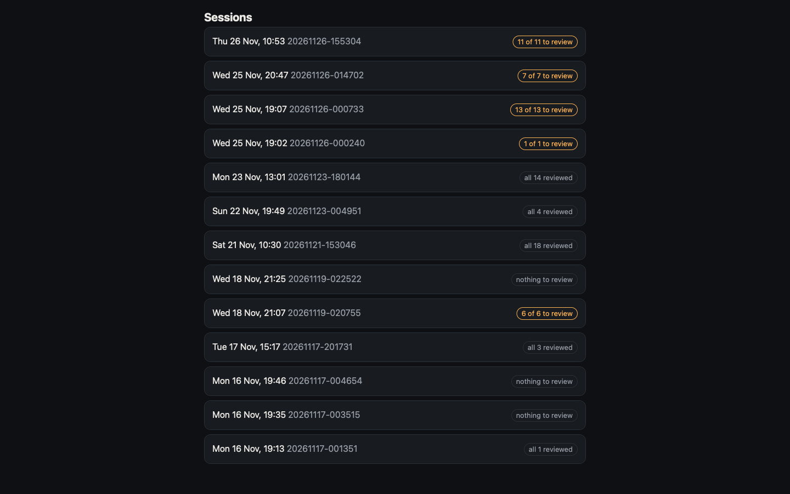 | 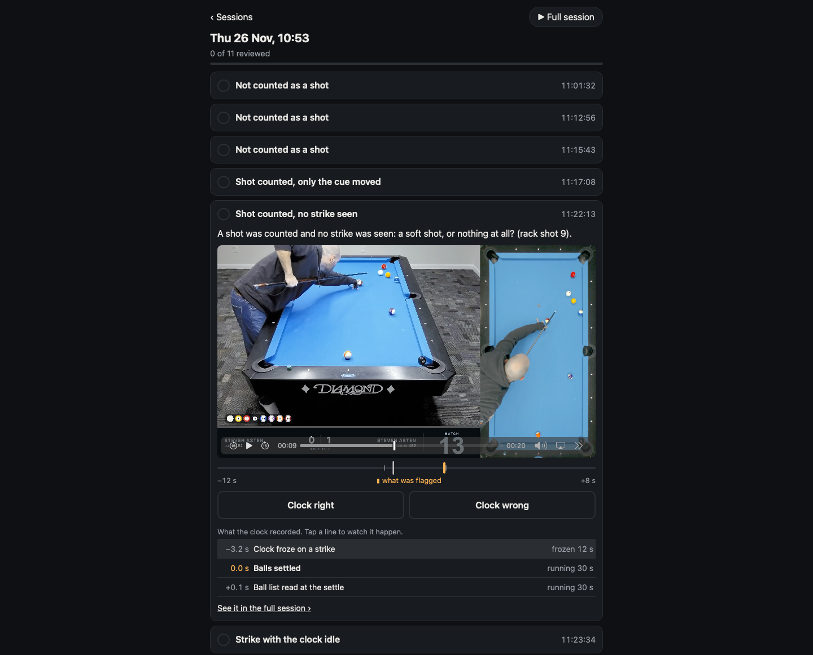 | 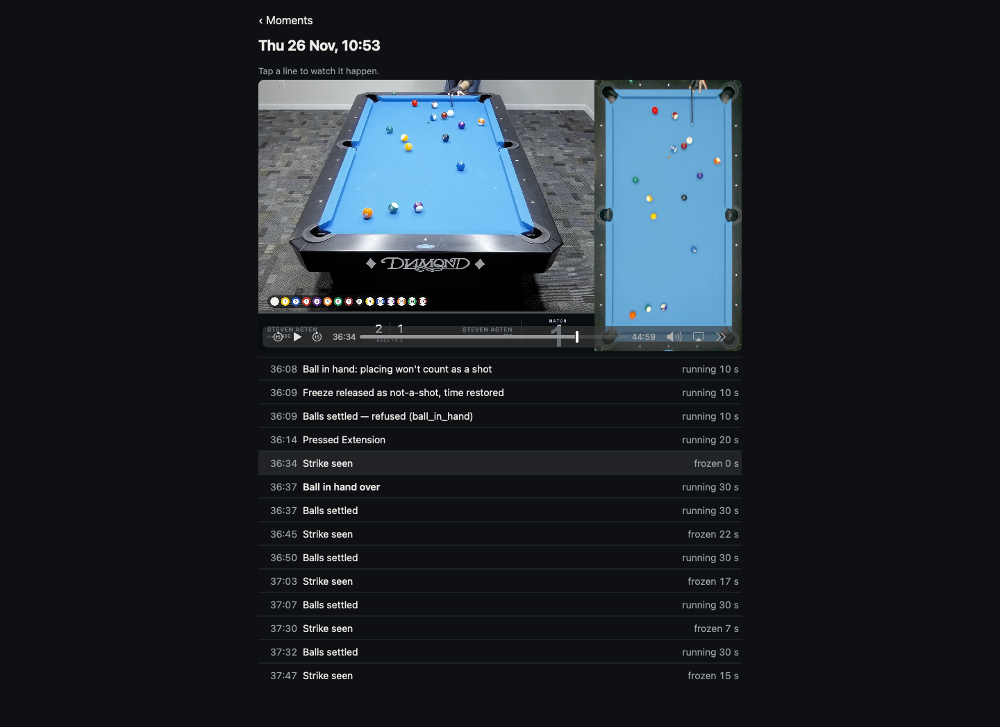 |

### The review agent

Under the last moment is a **Review done** button. It is optional. Pressing it
has the next maintenance pass run [Claude Code](https://claude.com/claude-code)
with the [`session-review`](.claude/skills/session-review/SKILL.md) skill. The
skill reads the wrong verdicts, finds the mechanism behind each one in the
journal, measures any rule it proposes against every journal on disk, and files
one GitHub issue of proposed changes. It never edits code: the run can read
anything and write only its own drafts and that one issue.
[#78](https://github.com/grassten/cueclock/issues/78) is one it filed.

### Streaming

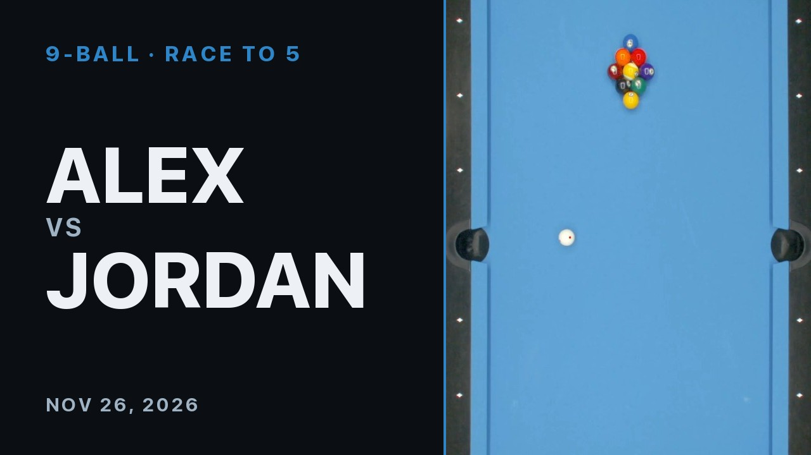

Holding the deck's Live key streams the session. Before OBS sends a frame, the
server makes the YouTube video itself: title (the match, the tournament, or
"Practice" and the date), visibility, description, category and a thumbnail it
draws from a still of the table. Only when YouTube says the video is ready does
OBS start, so there is never a stream with the wrong title on it. If YouTube
refuses, nothing goes on air and the key says why. The phone's Stream section
holds the title, the Unlisted or Public switch and, on air, the link. After the
session the maintenance pass adds a chapter for each game.

### Tournament nights

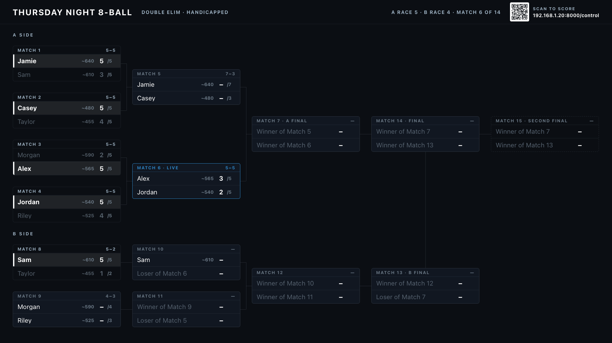

The Setup tab's other side runs a double-elimination tournament for 3 to 16
players. Every match is handicapped from the two players' FargoRate ratings:
the race is chosen from a ladder (5-5, 5-4, 6-4, 6-3, 7-3, 7-2) to bring the
weaker player's chance as near a target as it can without passing even. Players
keep score on their own phones; the `/bracket` page shows a QR code for the
address. Reaching a race only arms the result. The deck's Confirm key writes it,
loads the next match and puts the bracket on the TV for half a minute. With no
tournament loaded none of this is visible.

### Voice

Saying "extension" grants one. Recognition is offline
([Vosk](https://alphacephei.com/vosk/), small English model) and listens for
that one word, alone, at high confidence. The microphone is the side camera's.
The overlay answers "Extension called", and the listener is fed silence while
it does, so that it cannot hear itself.

### The side camera, the TV, recalibration

**The side camera** is an Insta360 Link 2C Pro that OBS owns. Its exposure,
white balance, focus and zoom are saved once (`cueclock sidecam save`) and
re-applied at every session start, so the vendor's app never has to be open.

**The TV** is switched on with a Wake-on-LAN packet and put in standby over the
Android TV remote protocol.

<a id="recalibration"></a>**Recalibration** is one held key. After the camera
is bumped, clear the table and hold Recal: it records three seconds of empty
table, refits the lens model and the table calibration from the cloth's own
edge, and swaps all three files in together. It refuses, changing nothing, if a
ball is on the cloth or the fit is off by more than 2 px.

## How detection works

The camera never moves, its exposure and white balance are locked, and the
light is the same every day. So a picture of the empty table is a model of the
background that stays true for months, and anything that differs from it is a
ball, a hand, a cue or a shadow. Every ball is tracked in table millimetres. A
strike is a still cue ball that suddenly has speed. A shot is over when every
ball has stopped. Whether that episode counts as a shot is decided once, when
the balls settle, with everything that is known about it by then.

There is no neural network. Every threshold is in millimetres, millimetres per
second, seconds or grey levels, and each one was set from a measurement on
recorded footage. The comment above each constant in the code says which.

| What the camera sees | What differs from the empty table | What the pipeline knows |
|---|---|---|
| 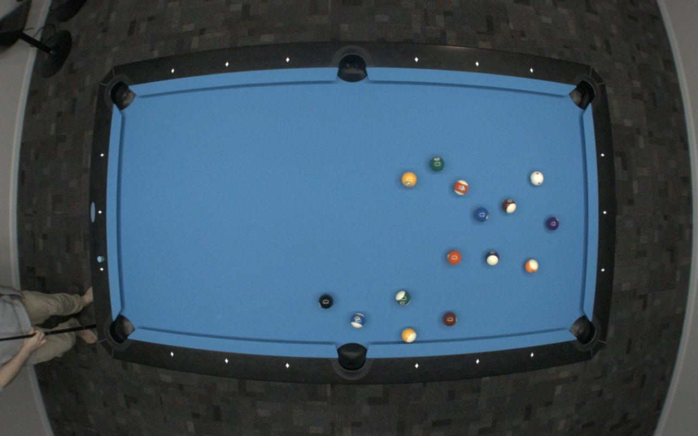 | 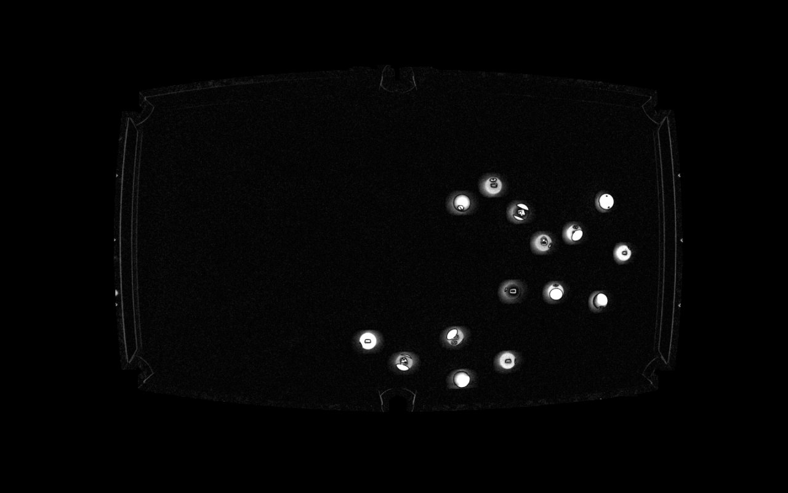 | 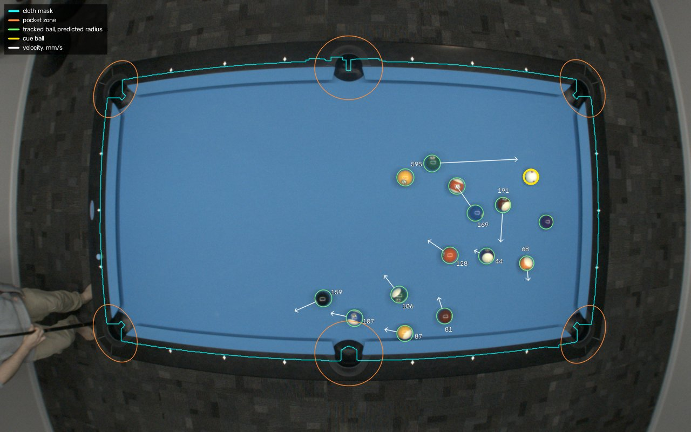 |

One frame about a second after a break, from a clip recorded in August, as the
camera sends it, as the detector sees it (the difference is shown four times
brighter), and with what the pipeline knows drawn on it: each ball at its
predicted size, its speed in mm/s, the cue ball in yellow, the six pocket
zones. [`scripts/draw_detections.py`](scripts/draw_detections.py) draws these
from any recorded clip.

The vision code is pure: a frame and a timestamp go in, events come out, with
no clocks, threads or files inside it. That is what lets a recorded clip be
replayed through it and give the same answer every time, and it is how every
change is graded ([Development](#development)).

### 1. The frame

The camera sends 8-bit raw Bayer frames, 1920 × 1200, about 156 a second, with
a global shutter. Exposure is fixed at 6 ms and gain at 12; every automatic
setting is off. Detection runs on every frame.

The grey image is one OpenCV call on the raw mosaic. Colour is never
reconstructed for detection: the three colour tests below read the 2 × 2 Bayer
cells directly.

The lens bends the picture hard (the table's edges bow visibly in the frame
above). Detection works on those bent pixels as they are. Only the centre of
each blob is undistorted and mapped to millimetres, which costs microseconds;
straightening whole frames is done only for the picture on the TV.

Finding blobs in a frame needs nothing from any other frame, so it runs on
three worker threads. One thread takes their results strictly in capture order
and runs everything that has memory: the tracker, the events, the clock. If the
workers fall behind, the camera drops frames; nothing queues.

### 2. The reference

The reference is a three-second clip of the empty table, recorded by
`recalibrate`. From 15 of its frames the pipeline builds, once at start-up:

- the **median grey image**, which is what every frame is compared against;
- the **cloth mask**: the pixels that are clearly blue, largest connected
  region, grown by 15 px so that a ball on a cushion is inside it;
- the **radius map**: how big a ball is, in pixels, at every point on the
  table. The calibration gives it. A ball is 18 to 24 px in radius depending on
  where it sits, nearly all of that perspective;
- the **cloth's colour**, as a direction in colour space. A shadow makes the
  cloth darker along that direction and leaves the others alone.

On the first live frame it compares 1,120 points straddling the cloth's four
edges with the reference. The same camera position reads about 2 grey levels of
difference; a camera moved 20 mm read about 35. Above 8 it warns that the
reference is stale, which matters because a stale reference fails silently: no
events, and a clock that never starts.

### 3. Finding balls

A pixel is foreground when its grey level differs from the reference by more
than 25, inside the cloth mask. After a small open and close, connected regions
are blobs. A blob is a ball when it does not touch the mask's edge, its area is
600 to 6,000 px², and its bounding box is at least 25 px on its short side and
at most 170 px on its long side.

That is the whole shape test, and what is missing from it is deliberate:
**nothing is rejected for not being round.** A fast ball smears into a streak
several diameters long, and a roundness test would report the table still in
the middle of a shot. This was the prototype's most expensive lesson.

Three things grey alone gets wrong, each with its own answer:

- **Shadows.** A blob as bright as 65 to 95% of the reference, with the cloth's
  colour unchanged, is the cloth in shadow and is dropped. The blue 2 on blue
  cloth reads exactly like that, so a blob that is a filled disc of ball size is
  kept whatever its colour says.
- **Balls as bright as the cloth.** The red 3 differs from the cloth by 21 grey
  levels, under the threshold of 25. A second channel measures colour change
  across the cloth's own colour direction, where a shadow reads zero and the
  red 3 does not. It only rescues: it adds a ball where grey found nothing.
- **Balls touching.** They arrive as one blob. Its thickness peaks at each
  ball's centre and dips where they touch, so cutting at three quarters of a
  ball radius leaves one core per ball. The split stands only if every part is
  a ball-sized disc.

Each ball also gets a **whiteness** reading: the share of pixels, in a ring at
55 to 83% of its radius, whose darkest colour channel is still bright. The ring
avoids both the numbered spot in the middle and the shaded rim. And it gets a
**churn** reading: how much its surface changed since a moment ago, which is
how a ball spinning in place is told from one at rest.

Blobs that fail are not thrown away silently. In a live session each one is
logged with the reason it failed, because a missed shot is nearly always
explained by what the detector discarded.

Carried by `DetectConfig` in
[`vision/detect.py`](src/cueclock/vision/detect.py); the measurements are in
`design.md` §2.3 and §4.1.

### 4. Calibration

There is no printed calibration target. The cloth's edge is four straight
lines in the world and a crisp blue-against-black edge in the picture, so it is
the target.

The lens model is a pinhole with two radial distortion terms. The focal length
is held at the lens's nominal value (3.5 mm over 3.45 µm pixels, 1014 px) and
the two terms are searched for the pair that makes the four cloth edges
straightest. A line through each straightened edge gives four corners, and
those four corners mapped onto a 1930 × 965 mm rectangle give the mapping from
pixels to millimetres. On the current camera position the edges come out
straight to 0.76 px.

One honest caveat: the edge that is fitted is the cloth's outline, cushions
included, not the playing area inside the cushion noses. Distances therefore
read short of true, by about 5% along the table and 10% across it (measured in
August). Every threshold was measured in the same units, so nothing depends on
the absolute scale, but the code's millimetres are not a tape measure's.

Carried by [`display/undistort_fit.py`](src/cueclock/display/undistort_fit.py),
[`vision/calibration.py`](src/cueclock/vision/calibration.py) and
[`recalibrate.py`](src/cueclock/recalibrate.py); `design.md` §4.3.

### 5. The tracker

Each detection is matched to the nearest track whose predicted position is
within 100 mm of it, nearest pairs first. Each track smooths its position and
velocity with an alpha-beta filter.

A track keeps **two speeds**. The smoothed one is quiet enough to say a ball is
at rest. The raw one is plain displacement over about 13 ms, and it shows the
step from rest to speed at a strike immediately, where the smoothed one lags.

A ball that stops being seen is not lost at once. A moving one is carried along
its path for a quarter of a second. A still one is held in place for up to
three seconds, because a ball being addressed is hidden under a hand for
seconds at a time and cannot move without being seen to.

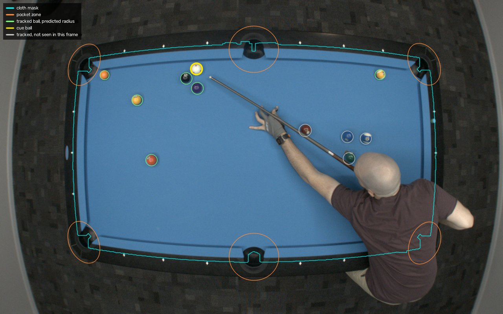

Above, the four balls in the shadow of the arm are not detected in this frame
and are held where they were last seen (grey). Nothing is drawn on the arm, the
hand or the cue: none of them is ball-shaped enough to be a detection.

**The cue ball is the whitest track**, provided its average whiteness is at
least 0.5. Another ball must be whiter by a margin to take the title, and
whiteness is not updated while a ball is moving fast and smeared.

A track seen in fewer than 70% of the last half second is not asked whether it
is moving or still. This is what keeps a hand, a cue or a flickering shadow
from having a say.

Carried by `TrackConfig` in
[`vision/track.py`](src/cueclock/vision/track.py).

### 6. The strike

A strike is not one signal. It is four things at once:

1. the cue ball **stood still** at one spot for at least 0.4 s;
2. it then **stepped** to at least 110 mm/s, having still been at rest 0.12 s
   earlier (a step, not a ramp: a ball being dragged ramps);
3. it **travelled**: 60 mm from its rest spot within 0.3 s, or 22 mm for a soft
   shot;
4. it travelled **in one direction**, along the line it set off on.

And one guard: it is not a strike if another ball was moving within 200 mm of
the cue ball's rest spot in the previous 0.4 s. That is a ball arriving to kiss
the cue ball, not a player.

That is the ordinary path. Three more exist for the ways the ordinary one goes
blind:

| Path | When | What it adds |
|---|---|---|
| Born at speed | the player's body hid the cue ball at address; its track died, and the strike appears as a new track already moving | at least 250 mm/s, a track under 0.1 s old, a quiet table around it, and a stricter confirmation |
| Own rest | the "cue ball" title is parked on the wrong ball | the struck ball's own rest record is used instead |
| Handoff | the cue ball's old track is still frozen at its rest spot while the struck ball shows up as a new one | the new track must surface within reach of the old one, in time |

Carried by `EventConfig` in
[`vision/events.py`](src/cueclock/vision/events.py); `design.md` §4.2.

### 7. The settle

Stillness is judged by position, not speed. The table is **moving** when a ball
that was standing on the last quiet table has moved more than 30 mm in 0.2 s,
or when a strike fires. It is **still** when every solidly seen ball has moved
5 mm or less over half a second and none is spinning. After half a second of
that, the balls have **settled**. A brief flicker of motion has to last 0.2 s
before it resets the count, which stops a ball rocking in a pocket jaw from
holding the table open.

Which tracks may say "the table is moving" is a list: the balls that were
standing the last time the table was quiet. A hand is never on it. A new track
gets a say only by proving it is a struck ball, with two consecutive readings
of 1,200 mm/s or more.

### 8. The decision at the settle

The clock does not wait for the strike to be seen. When the table starts
moving, the countdown **freezes**. When the balls settle, **one shot is counted
for the episode**, whether a strike was seen in it or not, and the next shot
gets a fresh countdown.

Then the exceptions. A settle is refused, and the frozen countdown carries on
from where it stopped, when the evidence says no shot was played: the cue ball
is exactly where it stood, the cue ball moved but was never seen rolling, or a
scratch has just happened and only the cue ball has moved since. A break that
left the rack standing sends the clock back to idle. Some of these need the
[ball list](#10-the-ball-list), which takes about 20 ms; a settle that might be
refused waits up to 0.3 s for it. The next section goes through them one at a
time.

This split, where the camera reports evidence and one place applies policy at
the settle, replaced an earlier design in which the strike detector had to be
right by itself. It is the largest single reason for the number at the top of
this page. Carried by [`server/hub.py`](src/cueclock/server/hub.py) and
[`server/scratch.py`](src/cueclock/server/scratch.py); `design.md` §14 to §23.

### 9. The clock

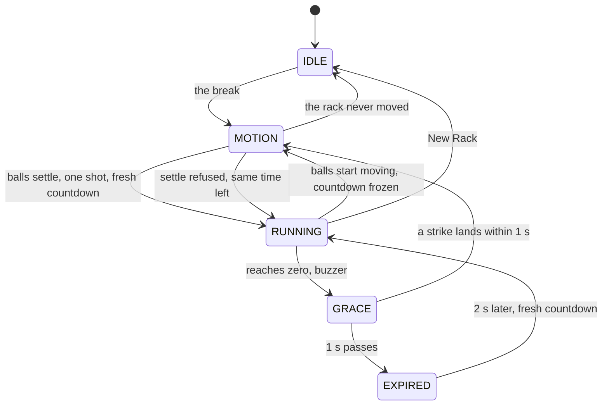

Five states. **Idle** between racks, where nothing on the table moves the
clock except a break. **Running** is the countdown. **Motion** is the countdown
frozen while balls roll. **Grace** is the second after zero, in which a stroke
that began before the buzzer can still be confirmed as a shot. **Expired** is
the foul; two seconds later the clock restarts itself.

The clock is its own small package with no knowledge of cameras
([`clock/state.py`](src/cueclock/clock/state.py)): it is driven by the same
handful of calls whether they come from the camera, a key or a test.

### 10. The ball list

Separate from all of the above, and never fed back into it: a reading of
**which balls are on a still table, by number**. It is taken at every settle
and about once a second while the table is at rest.

It finds circles rather than blobs, by letting every strong colour edge vote
for a centre one ball radius away. For each circle it reads the colour inside
(the nearest of eight, measured once from this ball set), and whether it is a
stripe (enough white in the middle, or white wrapping round the rim). Each
number is given to one ball. The cue ball is the circle with a white rim; if two
pass, the whiter one is the cue ball and the other is left off, because the
other is a sleeve logo or a glove.

It was built to draw the strip of chips on the bar. It turned out to be the
missing witness for the decisions above: the tracker knows what moved, and the
list knows what is there. "Was the cue ball on the table before this shot, and
is it gone now?" is a scratch. "Is the cue ball exactly where it was?" is a
shot that never happened.

Carried by [`vision/ball_list.py`](src/cueclock/vision/ball_list.py);
`design.md` §13, §19, §20.

### 11. What it costs

On the Mac mini M2, one frame, one thread, measured offline:

| Stage | Time |
|---|---|
| Raw to grey | 0.12 ms |
| Finding balls, with the colour channel and the split | 3.9 to 5.2 ms |
| Churn | 0.4 ms |
| Tracker and events | 0.08 ms |
| One ball list (not every frame) | 18 ms median |

The camera delivers 156 frames a second, and three workers can process about
420. Live, with OBS compositing two cameras and recording, detection holds a
median of 155 Hz and skips about 2% of frames. Finding balls takes about three
times its offline figure there, which was traced to OBS competing for memory
bandwidth.

Streaming to YouTube on top of that costs about 4 Hz at the median, with more
time under 150 Hz. Leaving the side camera's vendor app open during play cost
far more, roughly 125 Hz down to 80, and is the one thing that must not be
running.

Everything was tuned at 78 Hz, half the camera's rate, and runs at 156 with the
few frame-counted constants converted to the same span of time. Half of 78 was
measured too, and is in the next table but one.

## The hard cases, and what the clock does in each

Every row here was a failure in a real session before it was a rule. The right
column is where the measurement and the decision are written down, in
[`docs/design.md`](docs/design.md).

| Case | What happens today | Record |
|---|---|---|
| **A scratch** | The cue ball's track ending while it was moving within 120 mm of a pocket starts a one-second wait. A ball seen within 60 mm of where it was last seen cancels it: that is the cue ball hanging in the jaws. Otherwise it becomes a scratch candidate. A white ball at rest that was already on the table before the cue ball vanished refutes it; a white ball that appears afterwards does not, because that is the cue ball being put back. Separately, at every settle that counted a shot, the ball list asks whether the cue ball was there before the shot and is gone now. Either call holds the new countdown for 5 seconds. | §4.2, §14 |
| **Ball in hand after a scratch** | A state, not a guess made at each settle. It lasts from the scratch until the next shot that counts. While it lasts, a settle in which no object ball moved counts nothing and the countdown keeps running, unless the cue ball was seen rolling 400 mm or more. | §15, §18.1 |
| **The cue ball moved by hand at any other time** | A ball in a hand is never seen rolling by itself. A settle whose cue ball was never seen rolling, with every object ball still where it was, counts no shot. The countdown keeps running. | §21 |
| **The cue ball bumped with the shaft or the tip** | Counts as a shot, by decision. A bump is a foul, a foul ends the visit, and the clock resets either way. A foul bump and a legal soft shot are also the same pixels. | §8, §21 |
| **The break** | Untimed. Out of a fresh rack a strike of 2,500 mm/s or more takes the clock out of idle, and the first countdown starts when the balls settle. A break the strike logic reads too slow, or misses, is counted at the settle instead: five or more balls rearranged, or five or more balls that were one blob (the rack) now seen apart. | §2.1, §17 |
| **A strike that leaves the rack standing** | Not the break. The cue ball rolled out of a hand, or was picked up. If nine or more numbered balls stood before it and each is still within 3 px, the clock goes back to idle with nothing counted. | §17, §18.3 |
| **A strike nobody saw** | The balls moving froze the countdown anyway, and the settle counts the shot. | §2.1 |
| **Getting down on a shot** | An arm or a sleeve can hide balls, or drag a blob far enough to freeze the countdown. If the ball list then finds the cue ball exactly where it stood, the freeze is released with its time and no shot is counted. On a running clock, a settle with no motion behind it counts nothing. | §16, §19, §23 |
| **A bridge hand or a sleeve logo read as a ball** | The ball list keeps one cue ball, the whiter, and leaves a second off. | §20 |
| **A ball picked up** | A motion episode with no strike in it, whose moving balls all vanished away from a pocket after travelling no more than 400 mm, ends with no settle. The countdown resumes at the time it froze with. | §4.2 |
| **The player's body hides the cue ball at address** | Its track dies under the body, and the strike shows up as a new track born at speed. That has its own path, with stricter confirmation. | §4.2 |
| **Practice strokes, chalking, walking round the table** | Fail the strike test: nothing travels 22 mm from a ball that was at rest. Hands and cues cannot start a motion episode, because only balls that stood on the last quiet table can, and a track seen in under 70% of recent frames is not judged. | §4.2 |
| **A stroke that lands as the clock hits zero** | The buzzer sounds at zero, but for one more second a strike is still accepted and counted. | §2.1 |
| **Fast balls streak** | No blob is ever rejected for not being round. A blob too big for one ball is flagged; the tracker trusts it on a moving ball and ignores its position on a still one. | §2.3 |
| **Balls touching** | One blob is split where its thickness dips between the balls' centres, and the split stands only if every part is a ball-sized disc. A full rack is too big for this and is rejected whole; the ball list reads racks by fitting circles. | §4.1 |
| **The red 3 is as bright as the cloth. The blue 2 looks like a shadow.** | Two separate answers. A colour channel finds what grey cannot see. A filled disc of ball size is kept whatever the shadow test says. | §4.1 |
| **A ball spinning in place** | The shot is not over until the spin stops. For up to 10 seconds after a ball last moved, a surface that is still changing holds the settle. | §4.2 |
| **Racking between games** | Once New Rack is pressed the clock is idle: a settle does nothing and only a break starts it. The end of a rack is still that key press ([#72](https://github.com/grassten/cueclock/issues/72)). | §2.1 |

## Considered and rejected

"Measured" means measured here, on this table's footage or journals. The rest
were ruled out from other people's published work or by argument, and say so.

| Idea | Measured? | What was found | Record |
|---|---|---|---|
| A neural detector | no | With a fixed camera, locked exposure and a known background, differencing against the empty table does the job with nothing to train. Never built. | `design.md` §4.1, §6 |
| An adaptive background model (MOG2, KNN) | no | They learn a stopped ball into the background, and a stopped ball is the thing being watched for. | §4.1, §6 |
| Hough circles for the detector | no | Fragile, and unnecessary when the radius is known. The ball list does vote for circles of known radius, on colour edges. | §4.1, §13 |
| A roundness filter | on the prototype's footage | Fast balls streak, so a roundness filter reports the table still in the middle of a shot. | §2.3 |
| A ball looks bigger when it is lifted | measured | A carried ball does read 2.45 times a resting one, but only 1.14 times at the instant the false strike confirms, and a real strike merged with the cue reads 2.62. Built, measured, reverted. | §4.2; CHANGELOG checkpoint 56 |
| A hand over the spot where a ball arrives means it was carried | measured, live | Fired ten times in three weeks. Nine had the shape of an ordinary pot, and one refused a real shot that no hand was near. Deleted. | §8; checkpoints 91, 104 |
| How far the moving balls travelled separates real shots from phantoms | measured, twice | A fix built on it passed all 657 corpus tests and was wrong: a real shot travelled 489 mm, phantoms 364, 122 and 26. Reverted. | checkpoints 88, 104 |
| Speed separates a shot from a practice stroke | measured | A piece of the cue peaks at 1,576 mm/s. Real soft shots peaked at 124 and 225. | §8 |
| A strike that settles in under a second is a phantom | measured | A real pot settled in 0.73 s; the two phantoms it was meant to catch took 1.37 and 1.65 s. | checkpoint 88 |
| The sound of the strike | measured | In a quiet room all 41 strokes had a sharp onset. With music mixed in at an ordinary level, 16% could be found. Matches have music and talking. Ruled out for good. | §8 |
| Detecting on every fourth frame (39 Hz) | measured | Strokes detected fell from 53 of 54 to 45, and the break read as 1,731 mm/s against a floor of 2,500. | checkpoint 106 |
| A printed calibration target | no | The cloth's own edge fits to 0.76 px, and every clip passes on it. Never built. | §4.3 |

Four things were built, used and taken out again: an instant-replay key (used
five times in four months; a full recording of every session replaced it), a
key that saved the last 20 seconds of raw frames for later study (it asked the
player to classify a failure in the middle of a game), a set of practice
minigames (played once and not wanted), and named rulesets (replaced by the six
settings).

## What still goes wrong

- **The end of a rack is a key press.** Nothing read off the table ends a rack.
  Racking the balls before pressing New Rack, with the clock still running, can
  count shots that were not played ([#72](https://github.com/grassten/cueclock/issues/72)).
- **A cue ball rolled or pushed by hand counts as a shot.** Only a ball that is
  lifted and placed is told apart from one that was struck.
- **A hand hiding an object ball while the cue ball is placed** can make the
  placing count: the ball list cannot say the object ball stayed where it was.
- **A cue ball at rest in the deep shade of a rail** reads too dark to be
  recognised as white by the tracker, and cannot clear a false scratch by
  itself.
- **A real shot can be refused** when the cue ball stops within 30 mm of where
  the ball it potted was standing. One confirmed case.
- **A stripe resting with its white cap straight up** gets no number on the
  ball list until it rolls. A hand, a glove or a sleeve is sometimes read as a
  numbered ball. The list has no memory from one reading to the next.
- **"Extension" has to be said by itself**, and "attention" and "tension" are
  near enough to trigger it.
- **A shot that leaves neither a strike nor a settle leaves no trace**, so its
  rate is unknown by construction.
- **All of the evidence is one player, one table, one blue cloth and one ball
  set.**

## The rig

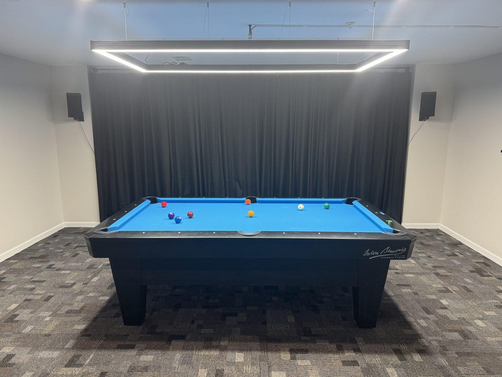

The table is a 7 ft Diamond with the blue Simonis cloth it came with, played
with an Aramith Tournament ball set. The light is a perimeter LED billiards
light, a rectangular frame hung on wires from the ceiling, and it is not
dimmable: on or off. The overhead camera hangs from the ceiling on a short
post inside the frame's outline, 56.5 inches above the cloth, looking straight
down, with its cable run along the ceiling in a raceway. The TV is on the wall at one end of the table, with the
side camera above it.

| The overhead camera | The TV wall, with the side camera above the TV |
|---|---|
| 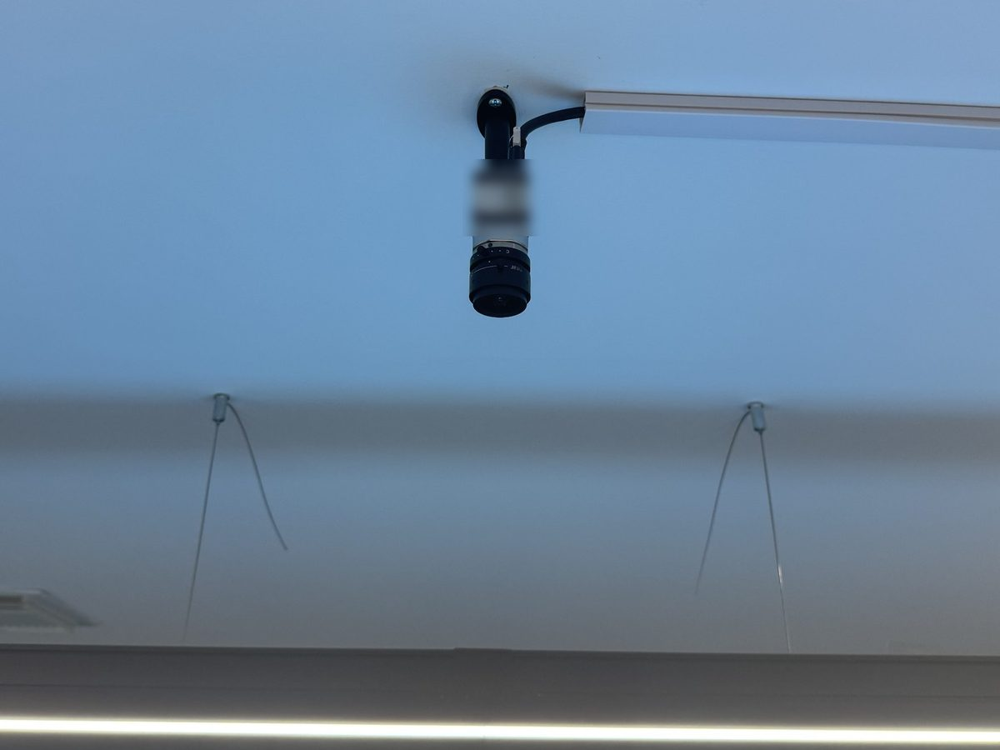 | 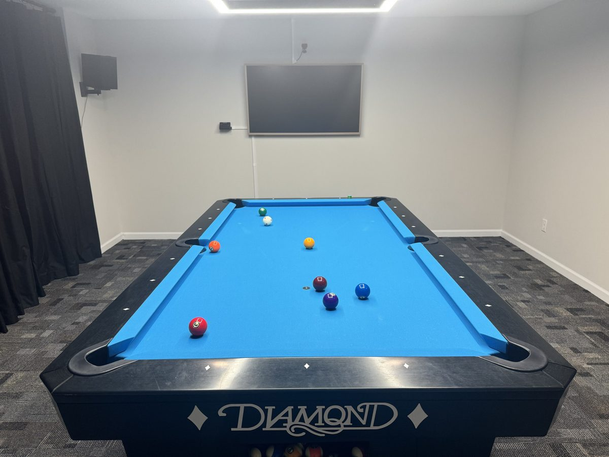 |

| Part | What it is for | The clock needs it? |
|---|---|---|
| Basler ace 2 a2A1920-160ucBAS | the overhead camera: colour, global shutter, 1920 × 1200 at up to 160 fps over USB 3 | yes |
| Kowa LM4NCL, 3.5 mm f/1.4, C-mount | wide enough to see the whole table from the ceiling | yes |
| Basler mounting plate 2200000314 | a ¼-20 thread on the camera body | yes |
| 5 m passive USB 3.0 cable, locking Micro-B to Type-A | straight into the Mac, never through a hub | yes |
| Mac mini M2, 24 GB | runs everything, and drives the TV over HDMI | yes |
| Hisense 55" CanvasTV | the wall display, and the speakers the clock's sounds play through | no |
| Elgato Stream Deck MK.2 | the keys at the table | no: the phone page does the same |
| Insta360 Link 2C Pro | the side angle on the stream, and the microphone for "extension" | no |
| Samsung T7, 4 TB | the archive of past sessions and the clip corpus | no |

The camera, lens, plate and cable came to about $660 in July 2026. With a Mac,
that is all the clock itself needs; everything else in the table is for the
wall and the stream.

**The optics.** The sensor is 6.6 × 4.1 mm with 3.45 µm pixels, so the 3.5 mm
lens has a focal length of 1,014 px, and the frame's width at a height *h*
above the cloth is 6.6 × *h* ÷ 3.5: at this camera's 56.5 inches, about
106 × 66 inches. The table fills about 70% of the frame's width. A ball is
36 to 49 px across depending on where it sits (measured over 106,000
detections): the corners are further away, and the lens squeezes the edges of
the frame. That lens
distortion is about −28% at the corners of the frame, which is why detection
works on the distorted pixels and only straightens coordinates
([How detection works](#1-the-frame)).

**The camera's settings** are saved in the camera as its power-on default
(UserSet1), and `run` re-applies the ones that matter at every start:

| Setting | Value |
|---|---|
| Pixel format | BayerRG8: 8-bit raw, decoded with OpenCV's `BayerBG` constants, because OpenCV names the pattern from the opposite corner |
| Exposure | 6,000 µs, automatic off |
| Gain | 12, automatic off |
| Frame rate | 160 asked; 156.25 delivered, which is the USB link's limit at 1920 × 1200 |
| White balance | fixed ratios saved in the camera, never touched by code |
| Iris and focus | about one stop down from wide open, locked with the lens's screws |

**Software.** macOS 26, Python 3.12 through [uv](https://docs.astral.sh/uv/),
OBS 33 with automatic updates off (an update once replaced OBS under a running
session and crashed it), Homebrew's `hidapi` for the Stream Deck and `ffmpeg`
for cutting clips. pypylon streams the camera without Basler's own software
installed. The Vosk model and the Insta360 SDK are downloaded by scripts and
never committed.

Three things are deliberately not installed, or not left open:

- **Elgato's Stream Deck app.** It takes exclusive control of the device.
- **pylon Viewer.** It does not exist for Apple Silicon. `scripts/live_view.py`
  does its job: a live view with a sharpness reading for focus.
- **Insta360 Link Controller, during play.** With its preview open, detection
  fell from about 125 Hz to 80 and OBS dropped 3.6% of its frames. It is
  opened once to set the side camera up, and closed.

## In a different room

Nothing here has been tried anywhere but this room. This section is a list of
what is tied to it, not a supported path.

**What the approach needs at all.** A camera that never moves and sees the
whole cloth with its edge. A global shutter. Exposure and white balance locked.
Raw frames at about 80 a second or more: everything was tuned at 78, and 39
lost strokes. A light that does not change.

**What carries over, and what would be measured again.** Thresholds in
millimetres, millimetres per second and seconds describe pool balls, and
should carry over. Thresholds in pixels and grey levels describe this camera
position and this light. Colours describe this cloth, these balls and this
white balance. None of them can be changed without editing code: there are
about 90 fields across `DetectConfig`, `TrackConfig` and `EventConfig`, about
45 more constants at module level, and no configuration file reaches any of
them.

**The ones a reader would not guess.**

- **The cloth has to be blue.** The table is found by a test for blue pixels
  (`display/undistort_fit.py`), and the lens fit, the calibration and the
  detection mask all start from it.
- **The table's size is written down twice**, in `vision/calibration.py` and in
  `EventConfig`, and neither reads the other. Six pockets are assumed.
- **The eight ball colours were read off one frame** of this ball set, an
  Aramith Tournament (`vision/ball_list.py`), under a white balance that is stored in the camera
  and not in the repo.
- **`run` talks to the camera through pypylon calls written into `cli.py`.**
  There is no camera interface to implement. What the vision code needs is
  small, though: a raw Bayer frame of constant size, a timestamp, and a steady
  known rate. `ClipReader` supplies exactly that from disk.
- **OBS has to contain** an input named `Syphon Client` and scenes named
  `Stream Detail` and `Bracket`. The [scene collection](assets/obs/scene-collection.json)
  has them.
- **The TV code** speaks Google TV's remote protocol and knows one Hisense
  art-mode app by name.
- **Paths and names in code:** the session archive at `/Volumes/T7`, ffmpeg at
  `/opt/homebrew/bin`, the microphone by its product name.

**What needs a Mac.** `run` always opens the picture feed for OBS (Syphon,
which is macOS only), and the deck, the three agents and the TV and OBS control
all lean on launchd, AppleScript and fixed macOS paths. The clock, the server
and its pages, the vision code, clip replay and the unit tests have nothing
Mac-specific in them, and CI runs the tests on Linux.

## Try it with no hardware

The clock, the pages and the tournament run without a camera:

```bash
uv sync
uv run python -m cueclock.server
```

Then open `http://localhost:8000/control` and
`http://localhost:8000/shotclock?view=full` side by side and press Start. The
clock is driven by hand, the ball strip stays empty, and nothing is written but
the score and settings under `config/`.

What a clone cannot do is run detection: the recorded clips it is graded on are
not published (a few seconds of raw frames is over a gigabyte).

## Running it on the rig

Day to day, nothing is typed: the deck's Session key starts everything and
holding it stops everything. Underneath, these are the commands, all run from
the repo root:

```bash
# the session: camera, vision, clock, server, the picture for OBS
uv run python -m cueclock.cli run --rectify --host 0.0.0.0 --fps 60

# the Stream Deck daemon (normally a launchd agent)
uv run python -m cueclock.cli deck

# after the session (both normally launchd agents)
uv run python -m cueclock.cli review serve       # the review page, :8001
uv run python -m cueclock.cli session maintain   # verify, cut, archive

# after the camera is bumped, with the table clear and the session stopped
uv run python -m cueclock.cli recalibrate
```

`--help` on any command, and [`docs/cli.md`](docs/cli.md) for every flag.

**From an unboxed camera to a session, in the order a new rig needs it.** Each
step is written up where the link points; this list is the order, not the
instructions.

| # | Step | Where |
|---|---|---|
| 1 | An Apple Silicon Mac with uv, OBS, and `brew install hidapi ffmpeg` | `hardware.md` §C3 |
| 2 | Plate and lens on the camera, mounted over the table, cable straight into the Mac | `hardware.md` §A1 |
| 3 | `uv sync` | |
| 4 | `uv run python scripts/live_view.py`: set the iris, focus to the sharpness peak, lock the lens screws | `hardware.md` §A3 |
| 5 | White balance against white paper, then save the settings as the camera's power-on default (UserSet1) | `hardware.md` §A4 |
| 6 | Clear the table and run `recalibrate`: it records the first reference and fits the lens and the table | `hardware.md` §E2, `cli.md` |
| 7 | `run` and open `/control` on a phone. **The clock is complete here**; everything after is presentation | |
| 8 | OBS: a Syphon source named `Syphon Client`, the bar as a browser source, the scenes, the colour LUTs, audio monitoring to the TV. The [scene collection](assets/obs/scene-collection.json) is the finished result | `hardware.md` §B3 |
| 9 | Turn on OBS's WebSocket server and write its address and password to `config/obs_websocket.json` | `hardware.md` §C4 |
| 10 | `scripts/install_deck_agent.sh` | `hardware.md` §C3 |
| 11 | The TV: Game Mode on, `scripts/pair_tv.py` with the TV on, then its address in `config/tv.json` | `hardware.md` §E1 |
| 12 | Voice: `scripts/fetch_vosk_model.sh` | `hardware.md` Part D |
| 13 | The side camera: set it up once in Link Controller and close it, `scripts/fetch_insta360_sdk.sh`, then `cueclock sidecam save` | `hardware.md` §F2 |
| 14 | YouTube, optional: a stream key in OBS, an OAuth client in `config/youtube.json`, sign in from the phone | `hardware.md` §B3 |
| 15 | `scripts/install_review_agent.sh`, and the maintenance agent (a `sed` and a `launchctl` line) | `cli.md`, `hardware.md` §C7 |
| 16 | The review agent, optional: Claude Code and `gh` signed in, and a token from `claude setup-token` | `hardware.md` §C7 |

Nothing in `config/` is committed: it is all written by these steps or by the
server. `recalibrate` making a rig's very first reference has been read
through, not run: it was built to replace an existing one.

## Development

```bash
uv sync                           # venv and dependencies, dev tools included
uv run pre-commit install         # once: ruff, gitleaks, bandit on commit
uv run pytest                     # unit tests anywhere; clip tests skip without the clips
uv run pytest -n 4                # the full battery with the clips: about 9 minutes
uv run pytest -n 4 --detect-cache # the same from stored detector output: about 30 seconds
uv run ruff check . && uv run mypy
```

- **uv only.** `uv add <pkg>`, never bare pip.
- **The clip corpus is the ground truth.** About seventy recorded scenarios,
  each a few seconds of raw frames with the events it must produce, replayed
  through the pure vision code. Every detection change is graded against all of
  them. They live on an external SSD behind the `tests/clips` symlink and are
  not published; without them the clip tests skip and the 977 unit tests still
  run. [`tests/README.md`](tests/README.md) explains the two tiers.
- **Nothing is tuned blind.** A constant changes when a measurement on the
  corpus or the journals says so, and the comment above it says which.
- **No test reaches YouTube, OBS, the TV or the camera.** Each has a fake.

## Where the reasoning is

This page says what the system is today. These say why.

| File | What it is |
|---|---|
| [`docs/design.md`](docs/design.md) | The decision record. Inside each section the oldest statement comes first and dated amendments follow, some of them reversals. Section numbers are cited from the code. |
| [`CHANGELOG.md`](CHANGELOG.md) | The checkpoint log, newest first: what changed each day, what was measured, and why. |
| [`docs/hardware.md`](docs/hardware.md) | The rig reference: camera settings, the path from the sensor to the TV, OBS, the Stream Deck's key map, the microphone, the TV, the side camera. |
| [`docs/cli.md`](docs/cli.md) | Every command and flag. |
| [`tests/README.md`](tests/README.md) | How the corpus battery works and what it costs. |
| [`CLAUDE.md`](CLAUDE.md) | The working brief given to Claude Code at the start of every session. |
| [Issues](https://github.com/grassten/cueclock/issues) | The work list, open and closed, with the evidence for each change. |

## The small print

**How it was built.** Four months, from the first commit on 27 July 2026, in
about 155 dated checkpoints. The code was written with
[Claude Code](https://claude.com/claude-code), working from session journals
and recorded clips. `CLAUDE.md` and the two skills under `.claude/skills/` are
left in as the working method, machine paths and all.

**Not a product.** The pages have no login. They are meant for a home network
and must never be reachable from outside it: anyone who can open the review
page can also press Review done.

**Not affiliated** with FargoRate, Diamond, Basler, Elgato, Insta360, OBS or
YouTube, or with any league or tour. The FargoRate lookup uses an undocumented
endpoint of their public search page and may stop working at any time.

**Thanks to** [pypylon](https://github.com/basler/pypylon) (Basler's camera
library), [OpenCV](https://opencv.org/), [Vosk](https://alphacephei.com/vosk/)
for offline speech recognition, [Kokoro](https://github.com/hexgrad/kokoro) for
the voice that says "Extension called", [Syphon](https://syphon.github.io/) for
the frame path into OBS, and Insta360's Link SDK, which is fetched at setup and
never committed.

**Contributing.** This is a personal rig. Questions and issues are welcome.
Pull requests may sit: every change to detection has to be graded against clips
that are not in the repo.

**License.** [MIT](LICENSE).
